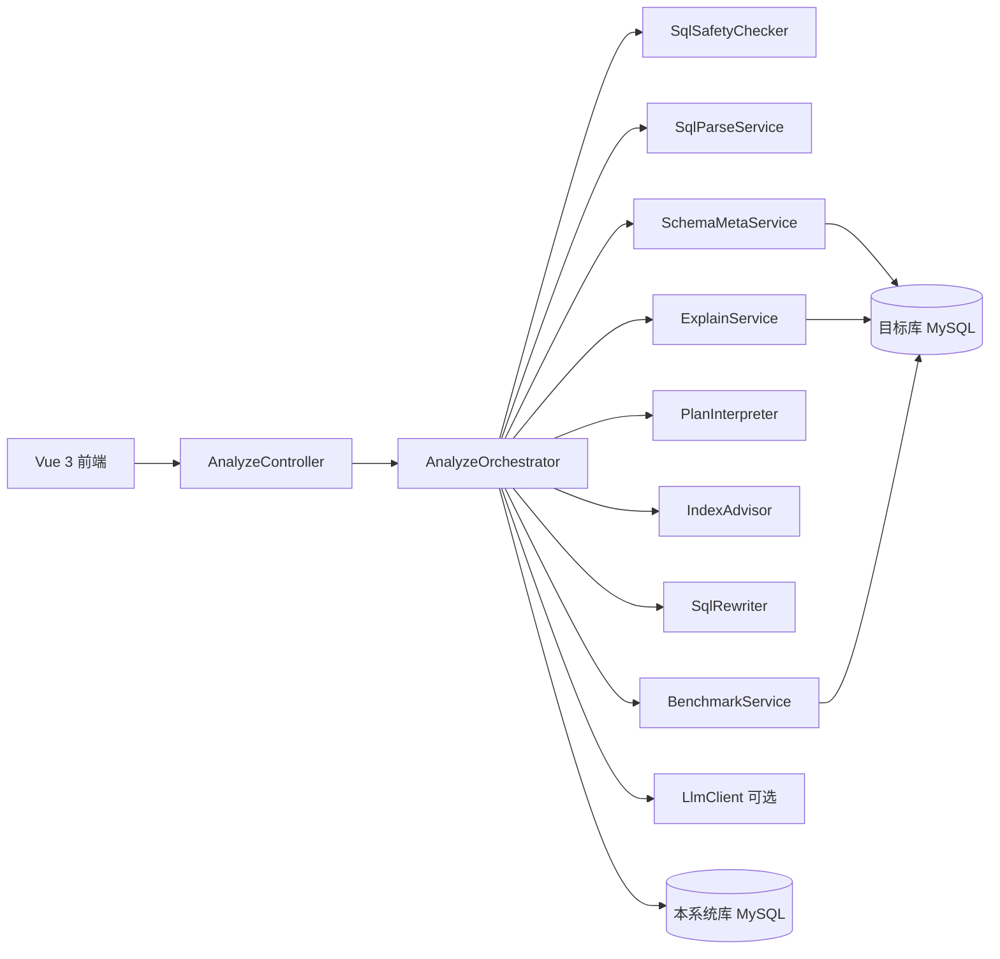

# SQL 智能分析与优化系统（sql-explan）

输入一条 MySQL `SELECT`，输出语义分析、执行计划解读、索引建议、SQL 改写与可选耗时对比。默认仅启用本地规则引擎，LLM 增强为可选项。

## 架构



## 本地开发启动

### 依赖

- JDK 17+（推荐 21）：`export JAVA_HOME=$(/usr/libexec/java_home -v 21)`
- Maven 3.9+
- Node.js 20+（前端）
- Docker（MySQL 与集成测试）

### 1. 数据库（不停止已在运行的容器）

```bash
docker compose up -d sqlexplan-mysql target-mysql
```

| 服务 | 容器名 | 宿主端口 | 用途 |
| --- | --- | --- | --- |
| sqlexplan-mysql | sqlexplan-mysql | 3307 | 本系统库 `sqlexplan` |
| target-mysql | sqlexplan-target-mysql | 3308 | 演示目标库 `demo` |

演示造数（可选）：

```bash
docker exec -i sqlexplan-target-mysql mysql -uroot -proot demo < docs/demo/seed.sql
```

### 2. 后端（8081）

```bash
cd backend
mvn spring-boot:run
```

Swagger：http://localhost:8081/swagger-ui.html

### 3. 前端（5173）

```bash
cd frontend
npm ci
npm run dev
```

访问 http://localhost:5173 ，开发代理将 `/api` 转发到 `http://localhost:8081`。

## Docker Compose 一键启动

含本系统库、目标库、后端与前端（避开宿主 80/8080：前端 **8088**、后端 **8081**、MySQL **3307/3308**）。

```bash
docker compose up -d --build
```

- 前端：http://localhost:8088
- 后端 API：http://localhost:8081
- Swagger：http://localhost:8081/swagger-ui.html

### 离线 / 内网镜像构建说明

镜像构建阶段不依赖运行时再拉外网依赖，需在有网络的环境预先准备：

| 组件 | 预先准备 |
| --- | --- |
| 后端 | 在 `backend/` 执行 `mvn dependency:go-offline`，或将宿主 `~/.m2` 挂载到构建容器的 `/root/.m2` |
| 前端 | 在 `frontend/` 执行 `npm ci` 后带着 `node_modules` 构建，或在能访问 npm 镜像源的 CI 节点构建镜像 |

也可将 `maven:3.9` / `node:22` 基础镜像换为内网 Harbor 镜像，并在 `Dockerfile` 中配置 `settings.xml` / `.npmrc` 指向内网仓库。

## 环境变量

| 变量 | 说明 | 默认 |
| --- | --- | --- |
| `SQLEXPLAN_AES_KEY` | 数据源密码 AES 密钥（建议 ≥32 字符） | `changeme-sqlexplan-dev-aes-key-32b` |
| `SQLEXPLAN_BENCHMARK_ALLOW_TEMP_INDEX_VERIFICATION` | 是否允许基准测试在目标库创建/删除临时索引以验证收益 | `false` |
| `sqlexplan.llm.enabled`（配置） | 是否调用 LLM | `false` |
| `ANTHROPIC_API_KEY` | Claude API 密钥；仅在 `sqlexplan.llm.enabled=true` 时需要 | 未设置则 LLM 调用失败并降级 |

`application.yml` 中 LLM 默认关闭；开启示例：

```yaml
sqlexplan:
  llm:
    enabled: true
```

```bash
export ANTHROPIC_API_KEY=sk-ant-...
```

## 安全说明

- 目标库连接 **只读**（`readOnly=true`），且经 `SqlSafetyChecker` 仅允许单条 `SELECT`。
- **请在测试库** 配置数据源；基准测试会对目标库真实执行 SQL。
- 临时索引验证需 **显式双开关**：`SQLEXPLAN_BENCHMARK_ALLOW_TEMP_INDEX_VERIFICATION=true` 且配置项 `sqlexplan.benchmark.allow-temp-index-verification: true`。
- 数据源密码加密存储，接口响应不返回密码；日志与 LLM 请求不含密码与业务数据行。

## Testcontainers（macOS）

集成测试 `BenchmarkIntegrationTest` 会在测试类加载时探测 Docker 套接字（`~/.docker/run/docker.sock` 等）。若仍无法连接，可手动设置：

```bash
export DOCKER_HOST=unix://$HOME/.docker/run/docker.sock
cd backend && mvn test -Dtest=BenchmarkIntegrationTest
```

集成测试优先使用 Testcontainers；若 Java 进程无法连接 Docker API（macOS 上常见），会自动 **回退到本机 `localhost:3308/demo`**（即 `docker compose` 的 target-mysql）。两者均不可用时才会跳过。

Surefire 已默认注入 `DOCKER_HOST=unix://$HOME/.docker/run/docker.sock`；若仍报 Docker 不可用，请手动 `export DOCKER_HOST` 后重跑。

## 局限性

- 首期仅支持 **MySQL 8.0**。
- 规则引擎与 LLM 建议均基于 EXPLAIN 与元数据启发式，不保证等价改写一定最优或语义完全等价（改写结果需看等价校验与人工确认）。
- 大结果集等价校验有行数上限；超大表 `COUNT(*)` 仅作风险提示。
- LLM 依赖外网与 API 配额，失败时自动降级为纯规则输出。

## 演示资料

- 造数脚本：[docs/demo/seed.sql](docs/demo/seed.sql)
- 10 条慢 SQL 与预期规则：[docs/demo/slow_sqls.md](docs/demo/slow_sqls.md)

## 测试

```bash
export JAVA_HOME=$(/usr/libexec/java_home -v 21)
cd backend && mvn test
cd frontend && npm run build
```
